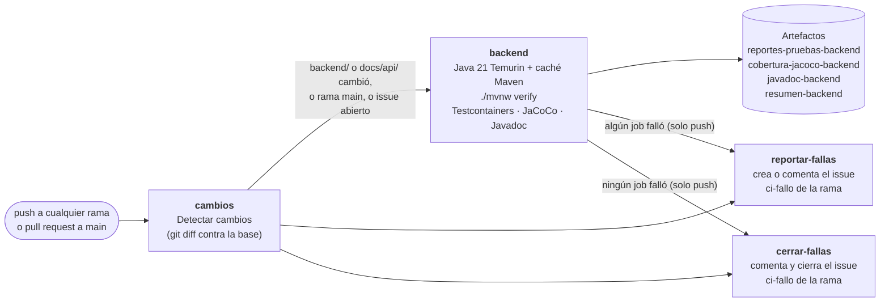

<!--
  Nombre: ci-cd.md
  Descripción: Documentación del pipeline de integración continua en GitHub Actions (.github/workflows/ci.yml):
               jobs, detección de cambios, artefactos, issues de fallas y configuración manual del repositorio.
  Fecha de creación: 2026-10-21
  Última actualización: 2026-10-21
  Autor: Juan Pablo Artunduaga Pérez (generado con Claude Code)
-->

# Integración continua (CI)

El pipeline está en [`.github/workflows/ci.yml`](../.github/workflows/ci.yml) y se ejecuta en cada **push a
cualquier rama** y en cada **pull request hacia `main`**. Por ahora solo prueba el backend; el despliegue y los
jobs de frontend, E2E y carga se agregarán en pasos posteriores.

## 1. Jobs



| Job | Cuándo corre | Qué hace |
| --- | --- | --- |
| `cambios` | Siempre | Compara el commit con su base y publica salidas `backend`, `frontend`, `e2e`, `load_tests`, `docs_api` y `todo`. Escribe la tabla de carpetas cambiadas en el Job Summary. |
| `backend` | Si la salida `backend` es `true` | Instala Java 21 Temurin con caché de Maven, ejecuta `./mvnw verify` (pruebas con PostgreSQL 18 en Testcontainers, umbral de cobertura del 70 %, Javadoc), publica los reportes y escribe el resumen. |
| `reportar-fallas` | Solo en `push` y solo si algún job falló | Crea un issue con la etiqueta `ci-fallo` o comenta el que ya esté abierto para la rama, y lo asigna al autor del push. |
| `cerrar-fallas` | Solo en `push` y solo si ningún job falló | Si la rama tiene un issue `ci-fallo` abierto, comenta que volvió a pasar y lo cierra. |

## 2. Detección de cambios

El job `cambios` usa `git diff --name-only` entre una base y el commit probado, sin acciones de terceros:

| Evento | Base de comparación |
| --- | --- |
| Pull request | Punto de unión entre la rama y `main` (`git merge-base`). |
| Push a una rama existente | El commit anterior del push (`github.event.before`). |
| Push de una rama nueva o push forzado | Punto de unión con `origin/main`. |

Cada carpeta vigilada genera una salida: `backend/`, `frontend/`, `e2e/`, `load-tests/` y `docs/api/`. La
salida `todo` se activa, y con ella todos los jobs, cuando:

- el push es a `main` (en `main` todo corre siempre);
- la rama tiene un issue `ci-fallo` abierto, para que `cerrar-fallas` solo cierre cuando **todo** pasó y no
  porque un job se omitió;
- cambió el propio pipeline (`.github/workflows/` o `.github/scripts/`);
- no se encontró una base de comparación.

El backend corre también cuando cambia `docs/api/`, porque `ContratoOpenApiTests` compara el contrato que genera
el código con `docs/api/openapi.yaml`.

Las salidas `frontend`, `e2e` y `load_tests` ya se calculan, aunque todavía no hay jobs que las usen.

## 3. Job backend

1. `actions/setup-java` con `distribution: temurin`, `java-version: 21` y `cache: maven` (la clave de caché
   depende de `backend/pom.xml`).
2. `./mvnw --batch-mode --no-transfer-progress verify -Dmaven.test.failure.ignore=true`. La propiedad hace que
   una prueba fallida no detenga Maven, para que JaCoCo y Javadoc se generen igual y el issue tenga toda la
   información. Un error de compilación, de Javadoc o una cobertura menor al 70 % (RNF-MAN-001) sí detiene el
   paso.
3. [`.github/scripts/resumen_pruebas_backend.py`](../.github/scripts/resumen_pruebas_backend.py) lee los XML de
   Surefire y `jacoco.csv` y escribe en el **Job Summary** las pruebas totales, fallidas y omitidas, la
   cobertura de líneas y de ramas, y la tabla de pruebas fallidas con su mensaje.
4. Se publican los artefactos (disponibles en la página de la ejecución):

   | Artefacto | Contenido | Retención |
   | --- | --- | --- |
   | `reportes-pruebas-backend` | `backend/target/surefire-reports/` (XML y TXT de Surefire) | 14 días |
   | `cobertura-jacoco-backend` | `backend/target/site/jacoco/` (abrir `index.html`) | 14 días |
   | `javadoc-backend` | `backend/target/reports/apidocs/` (abrir `index.html`) | 14 días |
   | `resumen-backend` | `resumen-backend.json`, usado por `reportar-fallas` | 7 días |

5. Si hubo pruebas fallidas, el último paso marca el job como fallido.

Los XML de Surefire usan el `@DisplayName` de cada prueba (configurado en `backend/pom.xml`), así la lista de
fallas muestra el identificador del criterio de aceptación, por ejemplo `[CA-RF-PRO-001-2] …`.

Las pruebas no necesitan secretos: el perfil `test` genera una clave JWT aleatoria y Testcontainers levanta
PostgreSQL 18 con el Docker del runner.

## 4. Issues de fallas

Cada rama tiene a lo sumo **un issue abierto** con la etiqueta `ci-fallo`. Se reconoce por la marca oculta
`<!-- ci-fallo-rama: <rama> -->` en su cuerpo; el título es `CI falló en la rama <rama>`.

| Situación | Acción |
| --- | --- |
| Falla y la rama no tiene issue abierto | Crea el issue (y la etiqueta `ci-fallo` si no existe) y lo asigna al autor del push. |
| Falla y la rama ya tiene issue abierto | Agrega un comentario con los datos de la nueva falla y suma como asignado al autor del push. |
| Pasa y la rama tiene issue abierto | Comenta "La rama vuelve a pasar" con el commit y la ejecución, y cierra el issue. |
| Pasa y no hay issue | No hace nada. |

El issue y cada comentario incluyen rama, commit enlazado, autor del commit, quién hizo el push, enlace a la
ejecución, el resultado de cada job y la tabla de pruebas fallidas con su mensaje (hasta 50; el resto queda en
el artefacto).

Los issues se gestionan solo desde los eventos `push`, porque siguen el estado de la rama. Un pull request ya
muestra su resultado en sus checks; además, el commit de merge que prueba puede dar un resultado distinto al
de la rama, y desde un fork el token no tiene permiso para escribir issues.

## 5. Permisos y concurrencia

- Permiso por defecto del `GITHUB_TOKEN`: `contents: read`. `cambios` agrega `issues: read`, y
  `reportar-fallas` y `cerrar-fallas` agregan `issues: write`. Ningún job tiene más permisos.
- Un push nuevo a la misma rama cancela la ejecución anterior, salvo en `main`.
- `reportar-fallas` y `cerrar-fallas` de una misma rama se turnan (grupo de concurrencia `ci-issue-<rama>`)
  para que dos ejecuciones seguidas no creen dos issues.

## 6. Configuración manual en GitHub

En el repositorio, como administrador:

1. **Settings → Actions → General**
   - *Actions permissions*: "Allow all actions and reusable workflows", o bien "Allow actions created by
     GitHub", porque el pipeline solo usa acciones de `actions/*`.
   - *Workflow permissions*: "Read repository contents and packages permissions" (el workflow pide
     `issues: write` por su cuenta). No hace falta marcar "Allow GitHub Actions to create and approve pull
     requests".
2. **Settings → General → Features**: debe estar activado **Issues**.
3. **Settings → Branches → Add branch ruleset** (o *Add classic branch protection rule*) para `main`:
   - Exigir un pull request antes de fusionar.
   - Exigir que pasen los checks: `Detectar cambios` y `Backend (mvnw verify)`. Solo aparecen en la lista
     después de que el workflow se haya ejecutado una vez.
   - Exigir que la rama esté al día con `main` antes de fusionar.
   - Bloquear los push forzados y el borrado de la rama.

Como `backend` se omite cuando un pull request no toca `backend/` ni `docs/api/`, GitHub considera exitoso un
check requerido que fue omitido por su condición `if`, así que esos pull requests no quedan bloqueados.

## 7. Ejecutar lo mismo en local

```powershell
cd backend
.\mvnw.cmd verify
cd ..
python .github/scripts/resumen_pruebas_backend.py --surefire backend/target/surefire-reports --jacoco backend/target/site/jacoco/jacoco.csv --salida-json resumen-backend.json
```

Para validar la sintaxis del workflow con Docker:

```powershell
docker run --rm -v "${PWD}:/repo" -w /repo rhysd/actionlint:latest -no-color
```
