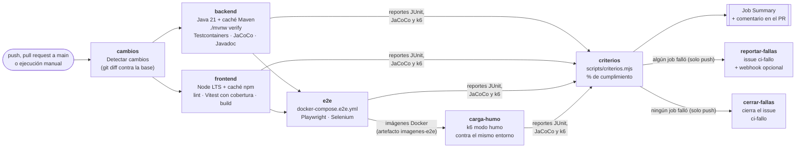

<!--
  Nombre: ci-cd.md
  Descripción: Documentación del pipeline de integración continua en GitHub Actions (.github/workflows/ci.yml):
               jobs (backend, frontend, e2e, carga de humo, criterios), detección de cambios, artefactos,
               cumplimiento de criterios, issues de fallas, aviso por webhook, configuración manual y cómo probarlo.
  Fecha de creación: 2026-10-21
  Última actualización: 2026-10-21
  Autor: Juan Pablo Artunduaga Pérez (generado con Claude Code)
-->

# Integración continua (CI)

El pipeline está en [`.github/workflows/ci.yml`](../.github/workflows/ci.yml) y se ejecuta en cada **push a
cualquier rama**, en cada **pull request hacia `main`** y a mano desde la pestaña Actions (**Run workflow**). Prueba
el backend, el frontend, los flujos end-to-end y la carga de humo, y mide el cumplimiento de los criterios de
aceptación. Cuando la CI termina con éxito en `main`, el workflow `deploy.yml` despliega a producción
(Render + Neon); se documenta en [despliegue.md](despliegue.md).

## 1. Jobs



| Job | Cuándo corre | Qué hace |
| --- | --- | --- |
| `cambios` | Siempre | Compara el commit con su base y decide qué jobs corren (sección 2). Escribe en el Job Summary las carpetas que cambiaron y los jobs que se ejecutan. |
| `backend` | Salida `backend` | Java 21 Temurin con caché de Maven, `./mvnw verify` (PostgreSQL 18 en Testcontainers, cobertura mínima 70 %, Javadoc), reportes y resumen. |
| `frontend` | Salida `frontend` | Node LTS con caché de npm, `npm run lint`, `npm test -- --coverage` (JUnit + cobertura v8) y `npm run build`. |
| `e2e` | Salida `e2e`, después de `backend` y `frontend` | Construye las imágenes, levanta `docker-compose.e2e.yml` y ejecuta Playwright y Selenium. |
| `carga-humo` | Salida `carga` y si `e2e` construyó las imágenes | Carga las imágenes de `e2e`, levanta el mismo entorno con base limpia y ejecuta k6 en modo humo (1 usuario, 30 s). |
| `criterios` | Siempre al final (salvo ejecución cancelada) | Descarga todos los reportes, ejecuta `scripts/criterios.mjs`, publica el % de cumplimiento en el Job Summary y lo comenta en el pull request. |
| `reportar-fallas` | Solo en `push` y si algún job falló | Crea o comenta el issue `ci-fallo` de la rama con el cumplimiento y las pruebas fallidas; avisa por webhook si existe el secreto. |
| `cerrar-fallas` | Solo en `push` y si ningún job falló | Comenta y cierra el issue `ci-fallo` abierto de la rama. |

**e2e corre aunque fallen pruebas unitarias.** Su condición es que `backend` y `frontend` no se hayan cancelado
(pueden haber pasado, fallado o haberse omitido). Así una prueba unitaria rota no deja sin medir los criterios E2E y
de carga. Si el código no compila, falla la construcción de las imágenes dentro del propio job `e2e`. Del mismo modo,
`carga-humo` corre si `e2e` alcanzó a construir y publicar las imágenes, aunque alguna prueba E2E haya fallado.

## 2. Detección de cambios

El job `cambios` usa `git diff --name-only` entre una base y el commit probado, sin acciones de terceros:

| Evento | Base de comparación |
| --- | --- |
| Pull request | Punto de unión entre la rama y `main` (`git merge-base`). |
| Push a una rama existente | El commit anterior del push (`github.event.before`). |
| Push de una rama nueva, push forzado o ejecución manual | Punto de unión con `origin/main`. |

**Se ejecuta todo** (salida `todo`) cuando:

- el push es a `main`, el evento es un pull request hacia `main` o es una ejecución manual;
- la rama tiene un issue `ci-fallo` abierto, para que `cerrar-fallas` solo cierre cuando **todo** pasó y no porque
  un job se omitió;
- cambió el propio pipeline (`.github/workflows/`, `.github/scripts/` o `scripts/junit.mjs`);
- no se encontró una base de comparación.

En las demás ramas corre solo lo afectado:

| Cambió | backend | frontend | e2e | carga-humo |
| --- | --- | --- | --- | --- |
| `backend/` | ✔ | | ✔ | ✔ |
| `docs/api/` | ✔ | | | |
| `frontend/` | | ✔ | ✔ | ✔ |
| `e2e/` | | | ✔ | |
| `load-tests/` | | | ✔ | ✔ |
| `docker-compose.e2e.yml`, `.env.example` | | | ✔ | ✔ |

- El backend corre también cuando cambia `docs/api/`, porque `ContratoOpenApiTests` compara el contrato que genera
  el código con `docs/api/openapi.yaml`.
- Un cambio en `load-tests/` ejecuta también `e2e`, porque la carga de humo usa las imágenes que construye ese job.
- `criterios` corre siempre; con jobs omitidos, sus criterios aparecen como SIN PRUEBA y el Job Summary lo advierte.

## 3. Job backend

1. `actions/setup-java` con `distribution: temurin`, `java-version: 21` y `cache: maven`.
2. `./mvnw --batch-mode --no-transfer-progress verify -Dmaven.test.failure.ignore=true`. Una prueba fallida no
   detiene Maven, para que JaCoCo y Javadoc se generen igual. Un error de compilación, de Javadoc o una cobertura
   menor al 70 % (RNF-MAN-001) sí detiene el paso.
3. [`resumen_pruebas_backend.py`](../.github/scripts/resumen_pruebas_backend.py) escribe en el Job Summary las
   pruebas totales, fallidas y omitidas, la cobertura de líneas y ramas y la tabla de fallas.
4. Si hubo pruebas fallidas, el último paso marca el job como fallido.

Los XML de Surefire usan el `@DisplayName` de cada prueba, así la lista de fallas muestra el identificador del
criterio, por ejemplo `[CA-RF-PRO-001-2] …`. Las pruebas no necesitan secretos.

## 4. Job frontend

1. `actions/setup-node` con `node-version: lts/*` y `cache: npm` (clave: `frontend/package-lock.json`); `npm ci`.
2. `npm run lint` (ESLint con las reglas de JSDoc).
3. `npm test -- --coverage`: Vitest escribe `frontend/reportes/junit/resultados-frontend.xml` y la cobertura en
   `frontend/coverage/` (HTML, lcov y `coverage-summary.json`).
4. [`resumen_junit.mjs`](../.github/scripts/resumen_junit.mjs) escribe en el Job Summary pruebas, fallas y cobertura
   de líneas.
5. `npm run build`.

Lint, pruebas y build se ejecutan aunque uno falle (así el reporte tiene toda la información); cualquiera que falle
marca el job como fallido.

## 5. Job e2e

1. Node LTS con caché de npm de `e2e/playwright` y `e2e/selenium`; `npm ci` en las dos.
2. [`preparar_env_e2e.sh`](../.github/scripts/preparar_env_e2e.sh) crea el `.env` de la raíz con contraseñas y
   clave JWT **aleatorias en cada ejecución**, enmascaradas en los logs. No se necesitan secretos del repositorio.
3. Chromium de Playwright con caché (`~/.cache/ms-playwright`). Selenium usa el Google Chrome del runner; Selenium
   Manager descarga el chromedriver.
4. `docker compose -f docker-compose.e2e.yml build`; las imágenes del backend y del frontend se guardan con
   `docker save` en el artefacto `imagenes-e2e` (1 día) para la carga de humo.
5. `up -d --no-build --wait` (espera los healthchecks), luego Playwright (`npm test`, 1 reintento en CI) y Selenium
   (`npm test`). Selenium corre aunque Playwright falle.
6. Siempre: guarda `docker compose ps` y los logs de los contenedores y apaga el entorno.

## 6. Job carga-humo

Descarga `imagenes-e2e`, las carga con `docker load`, crea otro `.env` aleatorio y levanta el **mismo entorno**
(`docker-compose.e2e.yml`, base limpia con el escenario de prueba). k6 corre con la imagen oficial
`grafana/k6:2.3.0` en la red del runner:

```bash
docker run --rm --network host --user "$(id -u):$(id -g)" -v "$PWD:/repo" -w /repo \
  grafana/k6:2.3.0 run -e K6_MODO=humo load-tests/productos.js
```

El script lee la contraseña del usuario `jefe` del `.env` y escribe `load-tests/results/k6-resumen-humo.json`. Si
un umbral no se cumple (p95 ≥ 1 s o ≥ 1 % de fallas), k6 sale con código 99 y el job falla. El Job Summary muestra
usuarios, solicitudes, p95, fallas y el estado de cada umbral. En modo humo solo cuenta CA-RNF-REN-001-1;
CA-RNF-REN-003-1 exige 50 usuarios (modo carga, que se ejecuta a mano: ver
[`load-tests/README.md`](../load-tests/README.md)).

## 7. Job criterios

1. Descarga cada artefacto a la ruta que espera [`scripts/criterios.mjs`](../scripts/criterios.mjs):

   | Artefacto | Ruta |
   | --- | --- |
   | `reportes-pruebas-backend` | `backend/target/surefire-reports/` |
   | `cobertura-jacoco-backend` | `backend/target/site/jacoco/` |
   | `reportes-pruebas-frontend` | `frontend/reportes/junit/` |
   | `reportes-playwright` | `e2e/playwright/reportes/` |
   | `reportes-selenium` | `e2e/selenium/reportes/` |
   | `resumen-k6` | `load-tests/results/` |

2. Busca la última ejecución completada de este workflow en `main` (evento push) que conserve el artefacto
   `criterios` y descarga su `criterios.json` como **base de comparación** (permiso `actions: read`).
3. Ejecuta `node scripts/criterios.mjs --base base/criterios.json` (sin `--base` si no hay base). El script marca
   cada criterio como CUMPLE, FALLA o SIN PRUEBA, calcula el porcentaje y, con base, lista los criterios que
   **dejaron de cumplirse** y los que **empezaron a cumplirse**. Su código 1 (hay criterios en FALLA) no hace fallar
   este job, porque los jobs de origen ya fallaron; cualquier otro código sí.
4. Publica `criterios.md` completo en el **Job Summary** (porcentaje, tabla por requisito, cambios respecto a main,
   pendientes, todos los criterios y fuentes leídas), con un aviso de los jobs omitidos.
5. Publica el artefacto `criterios` (`criterios.json`, `criterios.md` y `criterios-resumen.md`, 30 días).
6. En un pull request, publica `criterios-resumen.md` como **comentario del PR**. Hay un solo comentario por PR
   (marca oculta `<!-- ci-criterios -->`): cada ejecución nueva lo actualiza en lugar de crear otro. Desde un fork el
   token no puede escribir y el paso solo deja un aviso.

## 8. Artefactos

| Artefacto | Job | Contenido | Retención |
| --- | --- | --- | --- |
| `reportes-pruebas-backend` | backend | XML y TXT de Surefire | 14 días |
| `cobertura-jacoco-backend` | backend | Reporte JaCoCo (abrir `index.html`) | 14 días |
| `javadoc-backend` | backend | Javadoc (abrir `index.html`) | 14 días |
| `resumen-backend` | backend | `resumen-backend.json` para el issue | 7 días |
| `reportes-pruebas-frontend` | frontend | JUnit XML de Vitest | 14 días |
| `cobertura-frontend` | frontend | Cobertura v8 (abrir `index.html`) | 14 días |
| `resumen-frontend` | frontend | `resumen-frontend.json` para el issue | 7 días |
| `imagenes-e2e` | e2e | Imágenes Docker del backend y del frontend | 1 día |
| `reportes-playwright` | e2e | Reporte HTML (`html/index.html`), JUnit y, de las pruebas fallidas, captura y traza (`artefactos/**/trace.zip`, se abre con `npx playwright show-trace`) | 14 días |
| `reportes-selenium` | e2e | JUnit y capturas de los escenarios fallidos | 14 días |
| `resumen-e2e` | e2e | `resumen-playwright.json` y `resumen-selenium.json` para el issue | 7 días |
| `logs-entorno-e2e` | e2e | Estado y logs de los contenedores | 14 días |
| `resumen-k6` | carga-humo | `k6-resumen-humo.json` | 14 días |
| `logs-entorno-carga` | carga-humo | Logs de los contenedores | 14 días |
| `criterios` | criterios | `criterios.json`, `criterios.md`, `criterios-resumen.md` | 30 días |

## 9. Issues de fallas y aviso por webhook

Cada rama tiene a lo sumo **un issue abierto** con la etiqueta `ci-fallo`. Se reconoce por la marca oculta
`<!-- ci-fallo-rama: <rama> -->` en su cuerpo; el título es `CI falló en la rama <rama>`.

| Situación | Acción |
| --- | --- |
| Falla y la rama no tiene issue abierto | Crea el issue (y la etiqueta `ci-fallo` si no existe) y lo asigna al autor del push. |
| Falla y la rama ya tiene issue abierto | Agrega un comentario con los datos de la nueva falla y suma como asignado al autor del push. |
| Pasa y la rama tiene issue abierto | Comenta "La rama vuelve a pasar" con el commit, la ejecución y el % de cumplimiento, y cierra el issue. |
| Pasa y no hay issue | No hace nada. |

El issue y cada comentario incluyen:

- rama, commit enlazado, autor del commit, quién hizo el push, enlace a la ejecución y % de cumplimiento;
- el resultado de cada job (backend, frontend, e2e, carga-humo, criterios);
- **Cumplimiento de criterios de aceptación**, con dos listas:
  - **Dejaron de cumplirse respecto a main**: criterios que en la última ejecución de `main` estaban en CUMPLE y
    ahora están en FALLA o SIN PRUEBA. Si no hay ejecución base de `main`, el issue lo indica y muestra solo la
    lista siguiente;
  - **Todos los criterios en FALLA en esta ejecución**, con las pruebas que fallaron;
- **Pruebas fallidas** de backend, frontend, Playwright y Selenium (hasta 50 por fuente; el resto queda en el
  artefacto), o el motivo por el que no hay pruebas (job omitido, compilación o entorno caídos);
- el resultado de la **carga de humo** (p95, fallas HTTP, umbrales).

Los issues se gestionan solo desde los eventos `push`, porque siguen el estado de la rama. Un pull request ya
muestra su resultado en sus checks y en el comentario de criterios.

### Aviso por webhook (opcional)

Si el repositorio tiene el secreto **`NOTIFICACION_WEBHOOK`**, `reportar-fallas` envía además un mensaje corto con
la rama, el commit, el % de cumplimiento, los criterios en FALLA, cuántos dejaron de cumplirse y los enlaces al issue
y a la ejecución. Si la URL es de Discord (`discord.com/api/webhooks/...`) el mensaje va en el campo `content`; con
cualquier otra (Slack: `hooks.slack.com/services/...`) va en `text`. Sin el secreto el paso aparece como omitido y el
job no falla; si el envío falla, queda una advertencia y el job tampoco falla.

Cómo obtener la URL:

- **Discord**: en el canal, *Editar canal → Integraciones → Webhooks → Nuevo webhook → Copiar URL del webhook*.
- **Slack**: crear una app en <https://api.slack.com/apps>, activar *Incoming Webhooks* y *Add New Webhook to
  Workspace* eligiendo el canal.

Cómo guardarla: *Settings → Secrets and variables → Actions → New repository secret*, nombre
`NOTIFICACION_WEBHOOK`. Nunca se escribe en el código ni en un archivo del repositorio.

## 10. Permisos y concurrencia

- Permiso por defecto del `GITHUB_TOKEN`: `contents: read`. `cambios` agrega `issues: read`; `criterios` agrega
  `actions: read` (artefacto de main) y `pull-requests: write` (comentario); `reportar-fallas` y `cerrar-fallas`
  agregan `issues: write`. Ningún job tiene más permisos.
- El secreto `NOTIFICACION_WEBHOOK` solo se expone al job `reportar-fallas`.
- Un push nuevo a la misma rama cancela la ejecución anterior, salvo en `main`.
- `reportar-fallas` y `cerrar-fallas` de una misma rama se turnan (grupo de concurrencia `ci-issue-<rama>`) para que
  dos ejecuciones seguidas no creen dos issues.
- El pipeline solo usa acciones de `actions/*`; k6 y jq corren como imagen Docker y comando del runner.

## 11. Configuración manual en GitHub

En el repositorio, como administrador:

1. **Settings → Actions → General**
   - *Actions permissions*: "Allow all actions and reusable workflows", o bien "Allow actions created by GitHub".
   - *Workflow permissions*: "Read repository contents and packages permissions" (el workflow pide lo demás por su
     cuenta).
2. **Settings → General → Features**: debe estar activado **Issues**.
3. **Settings → Secrets and variables → Actions** (opcional): secreto `NOTIFICACION_WEBHOOK` (sección 9).
4. **Settings → Branches → Add branch ruleset** (o *Add classic branch protection rule*) para `main`:
   - Exigir un pull request antes de fusionar.
   - Exigir que pasen los checks: `Detectar cambios`, `Backend (mvnw verify)`, `Frontend (lint, pruebas y build)`,
     `E2E (Playwright y Selenium)`, `Carga de humo (k6)` y `Criterios de aceptación`. Solo aparecen en la lista
     después de que el workflow se haya ejecutado una vez.
   - Exigir que la rama esté al día con `main` antes de fusionar.
   - Bloquear los push forzados y el borrado de la rama.

En un pull request hacia `main` corren todos los jobs, así que ningún check requerido queda omitido.

## 12. Cómo probar el pipeline

1. **Ejecución completa en una rama.** Haz push de la rama: como cambia `.github/`, corren todos los jobs. En la
   página de la ejecución revisa el Job Summary de `cambios` (qué corrió y por qué), de cada job y de `criterios`
   (porcentaje y tablas), y descarga los artefactos (reporte HTML de Playwright, cobertura, `criterios`).
2. **Pull request.** Abre un PR hacia `main`: corren todos los jobs y aparece el comentario de criterios. Un segundo
   push a la rama actualiza ese mismo comentario en lugar de crear otro.
3. **Detección de cambios.** Con el pipeline ya en `main`, crea una rama que solo cambie un archivo de `frontend/`:
   deben correr `frontend`, `e2e`, `carga-humo` y `criterios`, y omitirse `backend`. Con un cambio solo en
   `docs/`, únicamente `cambios` y `criterios`.
4. **Falla provocada.** En una rama, cambia el valor esperado de una prueba con `[CA-...]` (por ejemplo una de
   `frontend/src/**/*.test.jsx`) y haz push: el job falla, `criterios` marca ese criterio en FALLA y se abre el
   issue `ci-fallo` con el porcentaje, la lista "Dejaron de cumplirse respecto a main" (si ya hay una ejecución de
   `main`) y la lista de criterios en FALLA. Revierte el cambio y vuelve a hacer push: el issue recibe el comentario
   "vuelve a pasar" y se cierra.
5. **Webhook.** Crea el secreto `NOTIFICACION_WEBHOOK` y repite el punto 4: llega el aviso al canal. Sin el
   secreto, el paso "Avisar por webhook" aparece omitido.
6. **Ejecución manual.** *Actions → CI → Run workflow* sobre cualquier rama ejecuta todo.

## 13. Ejecutar lo mismo en local

```powershell
# Backend
cd backend; .\mvnw.cmd verify; cd ..

# Frontend
cd frontend; npm ci; npm run lint; npm test -- --coverage; npm run build; cd ..

# E2E y carga de humo (requiere .env: copiar .env.example; ver docs/pruebas-e2e.md)
docker compose -f docker-compose.e2e.yml up -d --build --wait
cd e2e/playwright; npm ci; npm test; cd ../selenium; npm ci; npm test; cd ../..
k6 run -e K6_MODO=humo load-tests/productos.js
docker compose -f docker-compose.e2e.yml down

# Resúmenes y criterios
python .github/scripts/resumen_pruebas_backend.py --surefire backend/target/surefire-reports --jacoco backend/target/site/jacoco/jacoco.csv --salida-json resumen-backend.json
node .github/scripts/resumen_junit.mjs --nombre Frontend --junit frontend/reportes/junit --cobertura frontend/coverage/coverage-summary.json --salida-json resumen-frontend.json
cd scripts; npm ci; cd ..
node scripts/criterios.mjs                                     # reportes/criterios/
node scripts/criterios.mjs --base ruta/a/otro/criterios.json   # con comparación
```

Para validar la sintaxis del workflow (incluye shellcheck de los pasos `run`) con Docker:

```powershell
docker run --rm -v "${PWD}:/repo" -w /repo rhysd/actionlint:latest -no-color
```
