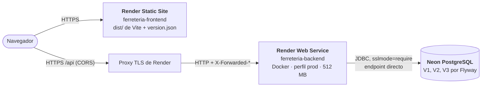
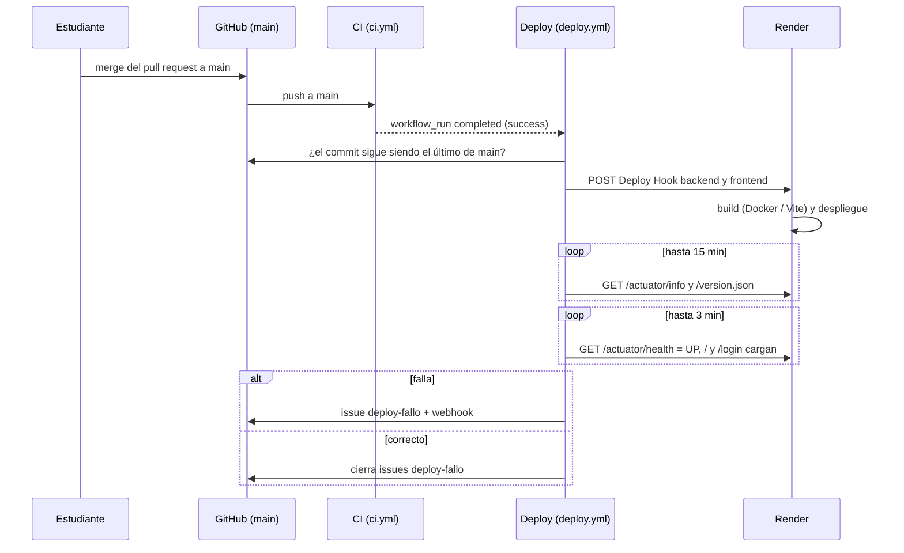

<!--
  Nombre: despliegue.md
  Descripción: Despliegue a producción: arquitectura (Render + Neon), flujo controlado por GitHub Actions
               (.github/workflows/deploy.yml), variables por servicio, creación de los servicios, límites del
               plan gratuito, consumo de memoria medido, cómo volver a la versión anterior y pasos manuales.
  Fecha de creación: 2026-10-21
  Última actualización: 2026-10-21
  Autor: Juan Pablo Artunduaga Pérez (generado con Claude Code)
-->

# Despliegue a producción

Producción usa tres servicios gratuitos: el backend en un **Web Service de Render** (imagen de
`backend/Dockerfile`), el frontend en un **Static Site de Render** (build de Vite) y la base de datos en
**Neon PostgreSQL**. Render nunca despliega por su cuenta. Solo despliega GitHub Actions, y únicamente
cuando la CI pasa en `main`.

## 1. Arquitectura



| Pieza | Dónde | Detalle |
| --- | --- | --- |
| Frontend | Render Static Site | `npm run build` con `VITE_API_URL` = URL del backend. Una regla de reescritura entrega `index.html` en cualquier ruta (React Router). `version.json` publica el commit. |
| Backend | Render Web Service (Docker) | `backend/Dockerfile`, perfil `prod`, puerto `PORT` de Render. TLS termina en Render; con `server.forward-headers-strategy=framework` la aplicación ve la solicitud como HTTPS y envía HSTS (RNF-SEG-006). Salud en `/actuator/health`; `/actuator/info` muestra el commit (`RENDER_GIT_COMMIT`). |
| Base de datos | Neon | Flyway aplica V1 (esquema), V2 (reportes) y V3 (auditoría) al arrancar. **Nunca** carga datos de dev, e2e ni pruebas: el perfil `prod` fija `spring.flyway.locations=classpath:db/migration`. |
| Administrador inicial | Backend | `InicializadorAdministrador` lo crea con `ADMIN_USUARIO`, `ADMIN_PASSWORD` y `ADMIN_CORREO` si no hay ningún administrador activo. En los arranques siguientes no hace nada. |
| Blueprint | `render.yaml` | Define los dos servicios con auto-deploy apagado (`autoDeployTrigger: "off"`). |

**Por qué el endpoint directo de Neon.** Neon ofrece dos hosts: el directo (`ep-...neon.tech`) y el
pooler (`ep-...-pooler.neon.tech`, PgBouncer en modo transacción). Flyway toma un bloqueo de sesión y
ejecuta la migración en una misma sesión, y el pooler no garantiza la misma sesión entre sentencias.
Por eso `DB_URL` usa el host directo con `sslmode=require`. Como el pool de Hikari está limitado a 5
conexiones, no hace falta el pooler.

## 2. Flujo de despliegue



1. **Disparo.** `deploy.yml` corre cuando el workflow `CI` termina en `main` por un push. Si la CI no
   terminó en `success`, el job se omite. También se puede lanzar a mano (Actions → Deploy → Run workflow)
   sobre `main`, por ejemplo después de cambiar una variable en Render.
2. **Environment `production`.** El job usa ese environment de GitHub, que guarda los secretos y
   variables del despliegue. Si se configuran revisores, el despliegue espera la aprobación.
3. **Commit vigente.** Un Deploy Hook de Render compila siempre el último commit de `main`. Si entró otro
   push mientras corría la CI, el despliegue se omite, porque la CI del commit nuevo hará el suyo. Así no
   se publica un commit que la CI no probó.
4. **Deploy Hooks.** Se llaman los dos hooks (`RENDER_DEPLOY_HOOK_BACKEND` y
   `RENDER_DEPLOY_HOOK_FRONTEND`). Sus URL son secretas y GitHub las enmascara en el log.
5. **Verificación de humo** (`.github/scripts/verificar_despliegue.sh`, siempre por HTTPS):
   - **Fase 1, hasta 15 min.** Espera a que `/actuator/info` del backend y `/version.json` del frontend
     publiquen el commit desplegado. Mientras Render compila, sigue respondiendo la versión anterior, y sin
     esta fase la verificación aprobaría la versión vieja. Compilar el backend con Maven en el plan
     gratuito tarda varios minutos.
   - **Fase 2, reintentos durante 3 min.** `/actuator/health` debe responder `UP`, y el frontend debe
     cargar en `/` y en `/login`. La segunda ruta comprueba la regla de reescritura. Los reintentos cubren
     el arranque en frío del backend gratuito.
6. **Resultado.** Si algo falla, se crea (o comenta) un issue con la etiqueta `deploy-fallo` con el
   commit, el autor, la CI que lo autorizó y la causa. Además se avisa por webhook si existe el secreto
   `NOTIFICACION_WEBHOOK`, el mismo de la CI. El siguiente despliegue correcto cierra el issue.

El script también sirve para verificar producción a mano (Git Bash o Linux):

```bash
bash .github/scripts/verificar_despliegue.sh https://ferreteria-backend.onrender.com https://ferreteria-frontend.onrender.com
```

## 3. Variables por servicio

### Backend (Render → ferreteria-backend → Environment)

| Variable | Obligatoria | Valor | Secreta |
| --- | --- | --- | --- |
| `SPRING_PROFILES_ACTIVE` | Sí | `prod` (la fija `render.yaml`) | No |
| `DB_URL` | Sí | `jdbc:postgresql://<host-directo>/<base>?sslmode=require` | Sí |
| `DB_USER` | Sí | Rol de Neon, por ejemplo `neondb_owner` | Sí |
| `DB_PASSWORD` | Sí | Contraseña del rol de Neon | Sí |
| `JWT_SECRET` | Sí | 32 caracteres o más. `render.yaml` la genera al azar; también sirve `openssl rand -base64 48` | Sí |
| `FRONTEND_URL` | Sí | URL del Static Site, sin barra final (único origen admitido por CORS) | No |
| `ADMIN_USUARIO` | Sí, la primera vez | Usuario del primer administrador | Sí |
| `ADMIN_PASSWORD` | Sí, la primera vez | Mínimo 8 caracteres con letras y números | Sí |
| `ADMIN_CORREO` | Sí, la primera vez | Correo del administrador (columna obligatoria y única) | No |
| `ADMIN_NOMBRE` | No | Por defecto `Administrador` | No |
| `OPENAPI_HABILITADO` | No | `true` por defecto (RNF-COM-001) | No |
| `PORT`, `RENDER_GIT_COMMIT` | — | Las define Render; no se configuran | — |

Si falta `JWT_SECRET` o `FRONTEND_URL`, el backend no arranca. Si faltan las variables `ADMIN_*` y no hay
administrador, arranca y registra una advertencia en el log.

### Frontend (Render → ferreteria-frontend → Environment)

| Variable | Obligatoria | Valor |
| --- | --- | --- |
| `VITE_API_URL` | Sí | URL del Web Service sin barra final, por ejemplo `https://ferreteria-backend.onrender.com`. Vite la incrusta al compilar: si cambia, hay que volver a desplegar. |

### GitHub (Settings → Environments → production)

| Nombre | Tipo | Valor |
| --- | --- | --- |
| `RENDER_DEPLOY_HOOK_BACKEND` | Secreto | Deploy Hook del backend (Render → Settings → Deploy Hook) |
| `RENDER_DEPLOY_HOOK_FRONTEND` | Secreto | Deploy Hook del frontend |
| `URL_BACKEND` | Variable | `https://ferreteria-backend.onrender.com` (la URL real del servicio) |
| `URL_FRONTEND` | Variable | `https://ferreteria-frontend.onrender.com` |
| `NOTIFICACION_WEBHOOK` | Secreto del repositorio, opcional | Mismo webhook de Discord o Slack que usa la CI |

## 4. Crear el proyecto en Neon

1. Entra a <https://console.neon.tech> y crea un proyecto (**New Project**):
   - **Postgres version:** 17 o 18. El esquema es compatible desde la 16.
   - **Region:** la más cercana a la región de Render. Por ejemplo, AWS US East (Ohio) con Render Ohio, o
     AWS US West (Oregon) con Render Oregon.
   - **Database name:** `ferreteria` (o deja `neondb`).
2. En **Connect**, desactiva **Connection pooling**. El host no debe contener `-pooler`.
3. Copia la cadena `postgresql://<usuario>:<clave>@<host>/<base>?sslmode=require` y sepárala en:
   - `DB_URL` = `jdbc:postgresql://<host>/<base>?sslmode=require`
   - `DB_USER` = `<usuario>`
   - `DB_PASSWORD` = `<clave>`
4. No ejecutes ningún script a mano. Flyway crea todo en el primer arranque del backend. La extensión
   `pg_trgm` que usa V1 está disponible en Neon.

## 5. Crear los servicios en Render

### Opción A: Blueprint (recomendada)

1. En <https://dashboard.render.com>: **New → Blueprint**, conecta el repositorio de GitHub y elige la
   rama `main`. Render lee `render.yaml`.
2. Render pide las variables `sync: false`. Para `FRONTEND_URL` y `VITE_API_URL` usa las URL que Render
   muestra para cada servicio (`https://<nombre>.onrender.com`). Si el nombre ya está tomado, Render agrega
   un sufijo; en ese caso corrige las URL después de crear los servicios.
3. **Apply.** El primer despliegue lo hace Render al crear los servicios. Los siguientes solo los hace
   GitHub Actions.

### Opción B: a mano

- **Backend:** New → Web Service → repositorio → Language **Docker**, Branch `main`, Dockerfile Path
  `./backend/Dockerfile`, Docker Build Context `./backend`, Instance Type **Free**, Health Check Path
  `/actuator/health`, variables de la sección 3.
- **Frontend:** New → Static Site → repositorio → Branch `main`, Build Command
  `cd frontend && npm ci && npm run build && printf '{"commit":"%s"}\n' "$RENDER_GIT_COMMIT" > dist/version.json`,
  Publish Directory `./frontend/dist`, variable `VITE_API_URL`. En **Redirects/Rewrites** agrega
  Source `/*`, Destination `/index.html`, Action **Rewrite**.

### En los dos casos

- **Settings → Build & Deploy → Auto-Deploy: Off** en ambos servicios (el Blueprint ya lo trae así;
  confírmalo).
- **Settings → Deploy Hook:** copia la URL de cada servicio para los secretos de GitHub. Es secreta:
  quien la tenga puede desplegar.

## 6. Límites del plan gratuito

| Servicio | Límite | Efecto en este sistema |
| --- | --- | --- |
| Render Web Service | 512 MB de RAM y 0,1 CPU | La JVM usa `-XX:MaxRAMPercentage=75` (heap de hasta 384 MB), SerialGC y pilas de 512 KB (ver sección 8). |
| Render Web Service | Se suspende tras 15 min sin tráfico | La primera solicitud después de la suspensión espera el arranque completo de Spring Boot (varios minutos con 0,1 CPU). Por eso la verificación reintenta. |
| Render Web Service | 750 horas de instancia al mes por cuenta | Alcanza para un servicio encendido todo el mes. |
| Render | Minutos de build mensuales limitados | Cada despliegue recompila la imagen; no conviene desplegar a mano en exceso. |
| Render Static Site | Ancho de banda mensual limitado | Suficiente para uso académico. |
| Neon | Almacenamiento y horas de cómputo mensuales limitados; se suspende tras 5 min sin uso | Al despertar tarda unos segundos; Hikari espera hasta 30 s por conexión y renueva las cortadas (`max-lifetime` de 5 min). |
| Neon | Historial de restauración corto | Limita hasta cuándo se puede volver atrás en la base (sección 9). |

Los valores exactos cambian con el tiempo. Consulta <https://render.com/docs/free> y
<https://neon.tech/pricing> antes de entregar. No se cumplen RNF-FIA-003 (99 % de disponibilidad) ni
RNF-REN-001 (p95 < 1 s) mientras el backend esté suspendido: es un límite del plan gratuito, no del
sistema.

## 7. Configuración de GitHub

1. **Settings → Environments → New environment →** `production`.
   - Opcional: **Required reviewers** (un humano aprueba cada despliegue).
   - **Deployment branches and tags → Selected branches →** `main`.
2. En ese environment, **Environment secrets:** `RENDER_DEPLOY_HOOK_BACKEND` y
   `RENDER_DEPLOY_HOOK_FRONTEND`. **Environment variables:** `URL_BACKEND` y `URL_FRONTEND`.
3. Si falta alguno, el despliegue falla en el paso **Verificar la configuración** y abre un issue
   `deploy-fallo` que dice cuál falta.

## 8. Memoria y arranque medidos

Medición local con la misma imagen y el perfil `prod`, limitada con
`docker run --memory=512m --memory-swap=512m`, contra PostgreSQL 18:

| Situación | Memoria del contenedor |
| --- | --- |
| Recién arrancado (Flyway V1–V3 aplicadas, administrador creado) | ≈ 300 MB |
| Tras 200 consultas concurrentes a `/api/v1/productos` | ≈ 320 MB (62 % del límite) |

| CPU asignada | Arranque hasta `/actuator/health` = UP |
| --- | --- |
| 0,5 CPU | ≈ 90 s |
| 0,25 CPU | ≈ 3 min (memoria ≈ 325 MB) |
| 0,1 CPU (límite estricto) | ≈ 8 min |

El arranque no supera la memoria: queda cerca de 200 MB por debajo del límite. Con 0,1 CPU como límite
estricto el arranque es lento; Render permite ráfagas, así que en la práctica suele ser menor. Esa es la
razón de la espera de 15 minutos de la fase 1.

En una prueba local, la suite de Playwright (2 workers en paralelo) contra un backend limitado a 512 MB
falló más que sin límite (8 frente a 4 de 10 pruebas, en un equipo donde la suite ya es inestable; en la CI
pasa completa). Por eso el límite no se agregó a `docker-compose.e2e.yml`: podría volver inestable la CI y
bloquear los despliegues. Si producción muestra lentitud con varios usuarios a la vez, el siguiente paso es
un plan de Render con más memoria.

Para repetir la medición (Git Bash, con una base PostgreSQL local o en Docker):

```bash
docker build -t ferreteria-backend ./backend
docker run --rm --memory=512m --memory-swap=512m --cpus=0.1 -p 8080:8080 \
  -e SPRING_PROFILES_ACTIVE=prod -e DB_URL=... -e DB_USER=... -e DB_PASSWORD=... \
  -e JWT_SECRET=... -e FRONTEND_URL=https://ejemplo -e ADMIN_USUARIO=... -e ADMIN_PASSWORD=... \
  -e ADMIN_CORREO=... ferreteria-backend
docker stats   # en otra terminal
```

## 9. Volver a la versión anterior

| Situación | Qué hacer |
| --- | --- |
| La versión nueva falla y no trae migraciones nuevas | En Render: servicio → **Events** → despliegue anterior correcto → **Rollback**. Es inmediato y no recompila. Hazlo en el backend y, si hace falta, en el frontend. |
| Dejar `main` coherente con lo desplegado | `git revert <commit>` en una rama, pull request y merge. La CI y el despliegue publican el código revertido. Mientras tanto no despliegues a mano: el Deploy Hook compilaría el último commit de `main`. |
| La versión nueva aplicó una migración Flyway (V4 o posterior) | Flyway solo avanza: la versión anterior no reconoce la migración nueva y `validate-on-migrate` puede impedir su arranque. Corrige hacia adelante con una nueva migración. Solo si los datos quedaron mal, restaura la base (fila siguiente). |
| Los datos quedaron mal | En Neon: **Branches → Restore** (restauración a un instante dentro del historial disponible) o crea una rama desde un punto anterior, verifícala y cambia `DB_URL` a esa rama. |

Antes de fusionar a `main` una migración nueva, conviene crear en Neon una rama de la base de producción
(**Branches → Create branch**) como punto de restauración.

## 10. Pasos manuales (resumen)

1. **Neon:** crea el proyecto (sección 4) y anota `DB_URL` (host directo, `sslmode=require`), `DB_USER`
   y `DB_PASSWORD`.
2. **Render:** New → Blueprint con este repositorio (sección 5). Llena `DB_URL`, `DB_USER`,
   `DB_PASSWORD`, `FRONTEND_URL`, `ADMIN_USUARIO`, `ADMIN_PASSWORD` y `ADMIN_CORREO` en el backend y
   `VITE_API_URL` en el frontend. `JWT_SECRET` la genera Render.
3. **Render:** espera a que el primer despliegue de ambos servicios termine, confirma **Auto-Deploy: Off**
   en los dos y copia los dos **Deploy Hooks**.
4. **Render:** abre `https://<backend>/actuator/health` (debe decir `UP`) y la URL del frontend. Inicia
   sesión con el administrador.
5. **GitHub:** crea el environment `production` con los dos secretos y las dos variables (sección 7).
6. **Primer despliegue por la CI:** haz merge de un pull request a `main`. Mira en Actions que **CI**
   termine en verde y que luego corra **Deploy**.
7. **Seguridad:** cambia la contraseña del administrador desde la aplicación. Después puedes borrar
   `ADMIN_PASSWORD` en Render, porque solo se usa si no existe ningún administrador.
