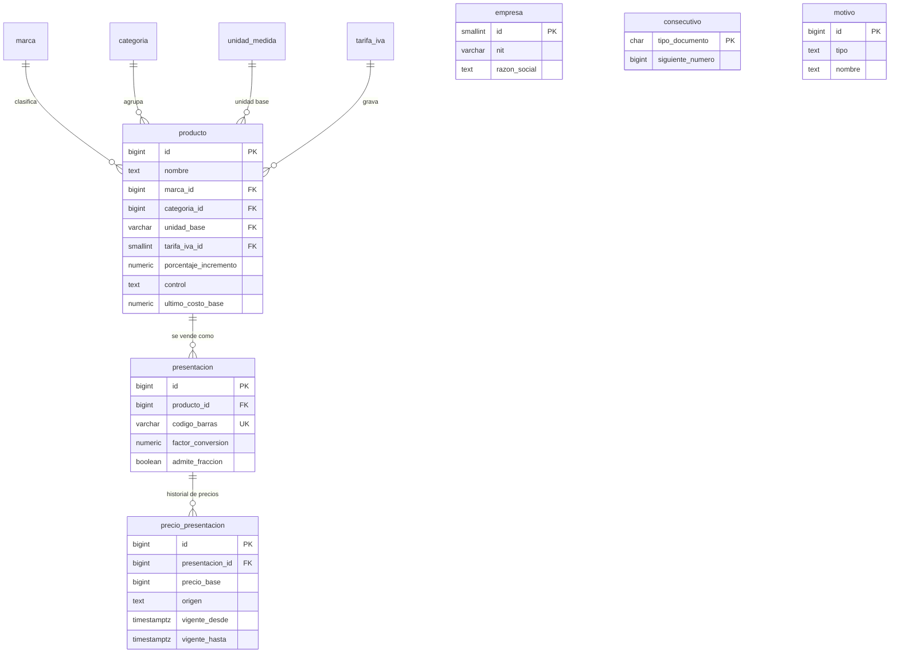
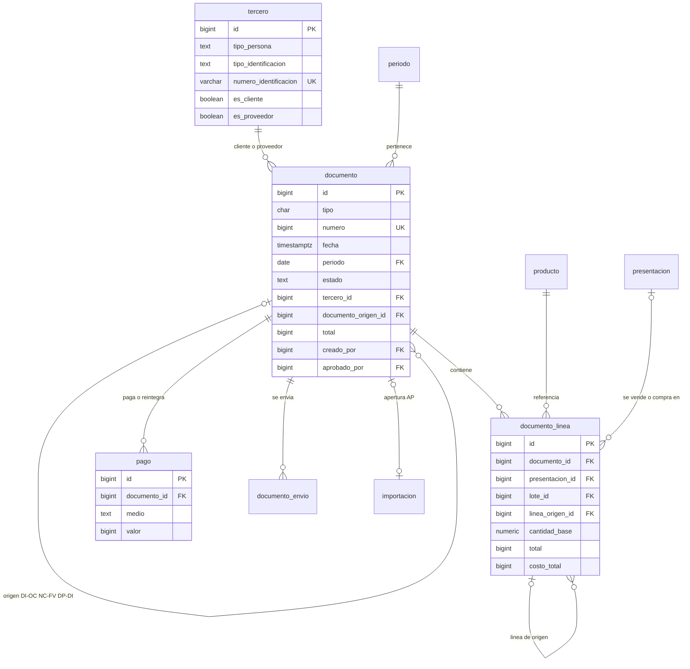
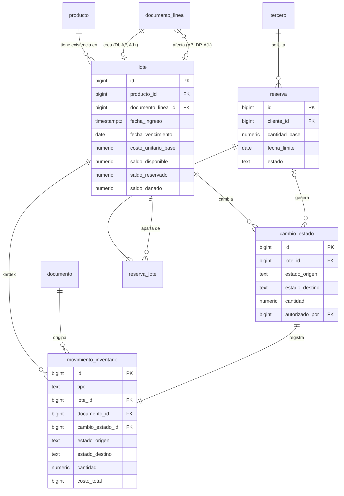
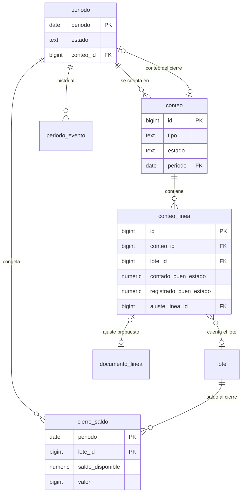
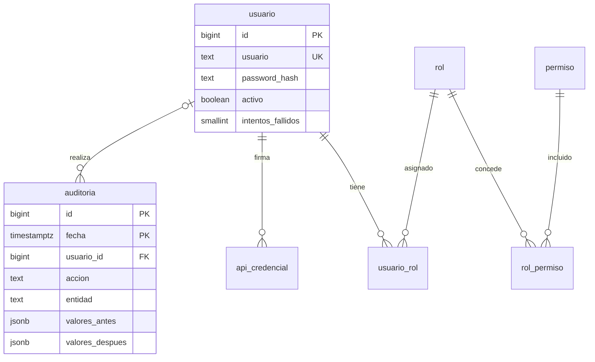

# Modelo de datos — Sistema de Inventario de Ferretería

Oct 19, 2026 · @Someone

El modelo tiene 33 tablas en PostgreSQL 16, en tercera forma normal, organizadas en 5 áreas; se deriva de la Especificación de Requisitos v4 (27 RF, 29 RN, 17 RNF).

## 1. Decisiones de diseño

| Decisión | Elección | Motivo |
| --- | --- | --- |
| Motor | PostgreSQL 16 | Transacciones ACID, bloqueo de filas (SELECT … FOR UPDATE), restricciones CHECK, índices parciales, JSONB y particionamiento; gratuito y disponible en los principales servicios de despliegue. |
| Claves primarias | `bigint GENERATED ALWAYS AS IDENTITY` | Soportan el volumen de diseño (9 millones de líneas de movimiento) sin riesgo de desbordamiento. |
| Nombres | snake\_case, tablas en singular, español sin tildes | Coherencia con los requisitos y portabilidad. |
| Dinero | `bigint` en pesos enteros | RN-06: COP sin decimales. |
| Costo unitario en unidad base | `numeric(18,4)` | Una caja de 12 a $10.000 cuesta $833,3333 por unidad; guardar 4 decimales evita acumular error. Todo valor que aparece en un documento se redondea al peso. |
| Cantidades | `numeric(14,3)` | RN-05: hasta 3 decimales; las unidades discretas se validan como enteras. |
| Fechas | `timestamptz` y `date` | Zona horaria America/Bogota en la aplicación (RNF-INT-003). |
| Enumeraciones | Columnas `text` con CHECK | Más fáciles de ampliar que los tipos ENUM de PostgreSQL. |
| Documentos | Un supertipo `documento` + `documento_linea` | Los 8 tipos (OC, DI, FV, NC, DP, AB, AJ, AP) comparten numeración, período, estado, usuario, aprobación y anulación; las relaciones entre documentos usan `documento_origen_id` y `linea_origen_id`. |
| Existencias | Saldos por estado dentro de cada `lote` | RN-03 y RN-13 se cumplen con un CHECK por columna; PEPS y FEFO se resuelven ordenando lotes. |
| Kardex | Tabla `movimiento_inventario`, una fila por lote afectado | Es la fuente del historial, del costo de venta y de las devoluciones al costo original (RN-19, RN-22). |
| Reglas complejas | En la aplicación; invariantes críticos también en la base | La base garantiza no negativos, unicidad, inmutabilidad, períodos cerrados y auditoría aunque falle el código. |

Se agrega el tipo de documento **AP (apertura)** para los lotes creados por la migración; así también cumplen RN-02 (todo cambio de existencias tiene documento). Es una extensión de RN-11 que no cambia ningún requisito.

## 2. Diagramas entidad-relación

El modelo se divide en 5 áreas; cada diagrama muestra sus tablas con claves y columnas principales, y las tablas de otras áreas solo como referencia. El detalle completo está en la sección 3.

| Área | Tablas | Cantidad |
| --- | --- | --- |
| Catálogo y configuración | unidad\_medida, tarifa\_iva, marca, categoria, motivo, producto, presentacion, precio\_presentacion, empresa, consecutivo | 10 |
| Terceros y documentos | tercero, documento, documento\_linea, pago, documento\_envio, importacion | 6 |
| Inventario | lote, movimiento\_inventario, cambio\_estado, reserva, reserva\_lote | 5 |
| Control y cierre | periodo, periodo\_evento, cierre\_saldo, conteo, conteo\_linea | 5 |
| Seguridad y auditoría | usuario, rol, permiso, rol\_permiso, usuario\_rol, api\_credencial, auditoria | 7 |

### 2.1 Catálogo y configuración



### 2.2 Terceros y documentos



### 2.3 Inventario



### 2.4 Control y cierre



### 2.5 Seguridad y auditoría



## 3. Diccionario de datos

Cada tabla aparece con su propósito, su clave y sus restricciones principales; la definición columna por columna, con comentarios que citan el requisito de origen, está en el script DDL (sección 6).

### 3.1 Catálogo y configuración

| Tabla | Propósito | Clave | Restricciones principales |
| --- | --- | --- | --- |
| unidad\_medida | 13 unidades base y si son discretas. | codigo | UND, PAR y JGO marcadas como discretas. |
| tarifa\_iva | Tarifas 0, 5 y 19 %. | id | Porcentaje único entre 0 y 100. |
| marca | Marcas del catálogo. | id | Nombre único sin distinguir mayúsculas. |
| categoria | Herramientas, eléctricos, plomería, etc. | id | Nombre único sin distinguir mayúsculas. |
| motivo | Motivos de daño, ajuste, baja, devolución y anulación. | id | Único por tipo y nombre. |
| producto | Artículo con marca, unidad base, IVA, margen y control. | id | Único por marca y nombre; garantía exige plazo y viceversa; margen 0 a 500 %. |
| presentacion | Forma comercial con código de barras y factor. | id | Código de barras único; factor mayor que 0; código interno con formato 20 + 11 dígitos. |
| precio\_presentacion | Historial de precios sin IVA. | id | Un solo precio vigente por presentación (índice único parcial); precio manual exige motivo. |
| empresa | Datos del emisor de documentos. | id = 1 | Fila única; dígito de verificación del NIT validado. |
| consecutivo | Siguiente número por tipo de documento. | tipo\_documento | Mayor que 0; se incrementa con bloqueo de fila. |

### 3.2 Terceros y documentos

| Tabla | Propósito | Clave | Restricciones principales |
| --- | --- | --- | --- |
| tercero | Clientes y proveedores, naturales o jurídicas. | id | Identificación única; NIT con dígito válido; nombres o razón social según tipo; al menos un rol; un solo consumidor final. |
| documento | Encabezado común de OC, DI, FV, NC, DP, AB, AJ y AP. | id | Número único por tipo; estados válidos por tipo; aprobador distinto del creador; total = subtotal − descuento + IVA + redondeo. |
| documento\_linea | Líneas de cualquier documento. | id | Cantidad mayor que 0; descuento 0 a 50 %; total de línea cuadrado; tarifa de IVA copiada al emitir. |
| pago | Pagos de facturas y reintegros de notas crédito. | id | Efectivo en múltiplos de $50; cambio = recibido − valor. |
| documento\_envio | Registro de envíos por correo. | id | Estado enviado o fallido. |
| importacion | Cargas desde Excel. | id | Una carga exitosa no tiene errores y genera su documento AP. |

### 3.3 Inventario

| Tabla | Propósito | Clave | Restricciones principales |
| --- | --- | --- | --- |
| lote | Capa de inventario con costo, vencimiento y saldo por estado. | id | Tres saldos mayores o iguales a 0; una línea de origen por lote; no se borra. |
| movimiento\_inventario | Kardex: una fila por lote afectado. | id | Solo inserción; viene de un documento o de un cambio de estado, nunca de ambos; sentido coherente con el tipo. |
| cambio\_estado | Traslados entre disponible, reservada y dañada. | id | Solo las 5 transiciones de RN-14; dañar exige motivo; retornar exige autorizador distinto; solo inserción. |
| reserva | Reserva de un cliente con plazo. | id | Plazo máximo de 7 días; consumida exige factura. |
| reserva\_lote | Lotes apartados por cada reserva. | reserva\_id, lote\_id | Cantidad mayor que 0. |

### 3.4 Control y cierre

| Tabla | Propósito | Clave | Restricciones principales |
| --- | --- | --- | --- |
| periodo | Estado de cada mes. | periodo (primer día del mes) | Cerrar exige meses previos cerrados y conteo total sin ajustes pendientes; reabrir solo el último. |
| periodo\_evento | Historial de cierres y reaperturas. | id | Reapertura con motivo de al menos 20 caracteres. |
| cierre\_saldo | Saldos por lote y estado al cierre. | periodo, lote\_id | Saldos y valor mayores o iguales a 0. |
| conteo | Conteo físico total o parcial. | id | El parcial exige alcance. |
| conteo\_linea | Cantidades contadas y registradas por producto o lote. | id | Una línea por producto y lote en cada conteo. |

### 3.5 Seguridad y auditoría

| Tabla | Propósito | Clave | Restricciones principales |
| --- | --- | --- | --- |
| usuario | Cuentas con hash de contraseña y control de bloqueo. | id | Usuario y correo únicos; no se eliminan. |
| rol | 6 roles de la matriz 2.2. | id | Código único. |
| permiso | 26 permisos de la matriz. | id | Código único. |
| rol\_permiso | Matriz rol × permiso. | rol\_id, permiso\_id | Cargada desde la especificación. |
| usuario\_rol | Roles de cada usuario. | usuario\_id, rol\_id | — |
| api\_credencial | Tokens de sistemas externos. | id | Token guardado como hash único. |
| auditoria | Registro de cambios, aprobaciones e inicios de sesión. | id, fecha | Particionada por mes; solo inserción; se depura por partición a los 24 meses. |

## 4. Integridad de las reglas de negocio

La base de datos garantiza 24 de las 29 reglas (13 por completo y 11 junto con la aplicación); las 5 restantes dependen de cálculos o de decisiones del flujo y quedan en la capa de aplicación, donde las cubrirán las pruebas automatizadas.

| Regla | Dónde | Mecanismo |
| --- | --- | --- |
| RN-01 Código de barras único / interno | Base | UNIQUE en `presentacion.codigo_barras`; `fn_codigo_interno` genera EAN-13 con prefijo 20 y CHECK de formato. |
| RN-02 Todo cambio con documento y usuario | Base | `movimiento_inventario` exige documento o cambio de estado (CHECK) y `usuario_id` NOT NULL. |
| RN-03 Sin saldos negativos | Base | CHECK ≥ 0 en los tres saldos de `lote`; la aplicación bloquea los lotes con `SELECT … FOR UPDATE`. |
| RN-04 Qué se puede vender | Base + app | Vista `v_lote_vendible` excluye vencidos y saldos en cero; la app consume solo desde ella. |
| RN-05 Unidades y 3 decimales | Base + app | `numeric(14,3)` y FK a `unidad_medida`; la app valida enteros en unidades discretas. |
| RN-06 Dinero entero, redondeo al peso | Base + app | Columnas `bigint`; la app redondea con mitades hacia arriba; CHECK de totales cuadrados en documento y línea. |
| RN-07 Redondeo a $50 en efectivo | Base | CHECK `valor % 50 = 0` en pagos en efectivo; `ajuste_redondeo` entra en el total. |
| RN-08 IVA por línea | Base + app | Tarifa copiada en `documento_linea.tarifa_iva`; un cambio de tarifa no altera documentos emitidos. |
| RN-09 Descuentos con tope | Base + app | CHECK 0 a 50 %; la app exige permiso `DESCUENTO_MAYOR` sobre 10 %. |
| RN-10 Contado y medios de pago | Base + app | CHECK de medios; la app verifica que la suma de pagos cubra el total. |
| RN-11 Numeración sin saltos | Base | `fn_siguiente_numero` actualiza `consecutivo` con bloqueo de fila: si la transacción falla, el número no se consume (una secuencia sí dejaría saltos). UNIQUE (tipo, numero). |
| RN-12 Documentos inmutables | Base | Trigger `fn_documento_inmutable`: solo permite las transiciones de OC y la anulación de FV del mismo día sin notas crédito; `fn_linea_inmutable` protege las líneas. |
| RN-13 Una bodega, tres estados | Base | Tres columnas de saldo en `lote`; no existe tabla de bodegas. |
| RN-14 Transiciones permitidas | Base | CHECK con las 5 parejas origen–destino en `cambio_estado`. |
| RN-15 Reservas de 1 a 7 días | Base + app | CHECK de plazo; tarea diaria de la app vence reservas. |
| RN-16 Daño con lote y motivo | Base | `lote_id` NOT NULL y CHECK de motivo al pasar a dañada. |
| RN-17 Baja aprobada con destino | Base + app | Estados PROPUESTO/APROBADO, aprobador distinto del creador, `destino_baja` restringido. |
| RN-18 Vencimientos y garantías | App | La app exige fecha en productos con vencimiento y calcula `fecha_fin_garantia`; índice de lotes por vencer. |
| RN-19 Orden FEFO/PEPS | Base + app | Índice y vista ordenados por vencimiento (nulos al final), ingreso e id; con fechas nulas el orden resultante es PEPS. |
| RN-20 Precio desde la última compra | App | La app recalcula al confirmar un DI; índice único parcial garantiza un solo precio vigente. |
| RN-21 Recepción ≤ lo ordenado | App | Se compara contra la suma de líneas con `linea_origen_id`. |
| RN-22 Devolución de cliente | App | La app reingresa a los lotes del kardex de la línea original, con su costo. |
| RN-23 Devolución a proveedor | App | La app descuenta los lotes creados por el DI de origen. |
| RN-24 Conteo antes del cierre | Base | Trigger `fn_validar_cierre` exige conteo total cerrado del mes y sin ajustes propuestos. |
| RN-25 Períodos cerrados | Base | Trigger `fn_validar_periodo` asigna el mes y rechaza operaciones en meses cerrados; `fn_validar_cierre` exige orden y solo reabre el último. |
| RN-26 Terceros | Base | CHECK de nombres por tipo, dígito de verificación con `fn_dv_nit`, índice único de consumidor final. |
| RN-27 Permisos y separación de funciones | Base + app | Tablas de roles y permisos; CHECK aprobador ≠ creador y autorizador ≠ usuario. |
| RN-28 Auditoría inmutable 24 meses | Base | Trigger `fn_auditar` en 21 tablas dentro de la misma transacción; `fn_solo_insercion` impide cambios; `fn_depurar_auditoria` elimina particiones viejas y deja constancia. La migración `V3__auditoria_ignora_control_acceso.sql` (RF-SEG-002: exactamente un registro por operación) hace que un UPDATE de `usuario` que cambia solo `intentos_fallidos`, `bloqueado_hasta` y `ultimo_acceso` no se audite, porque el inicio de sesión ya queda como `INICIAR_SESION` o `SESION_FALLIDA`; cualquier otra columna se sigue auditando como `MODIFICAR`, y un cambio de contraseña se audita con la marca `contrasena_cambiada` sin guardar el hash. La aplicación fija `app.usuario_id` y `app.ip` al iniciar cada transacción de escritura. |
| RN-29 Migración todo o nada | Base + app | La app carga en una transacción; CHECK exige 0 errores y documento AP en cargas exitosas. |

La auditoría registra cambios de configuración, catálogo, terceros, documentos, estados, reservas, conteos y períodos. Los movimientos de inventario no se duplican en ella: el kardex ya es un registro inmutable con usuario, fecha y documento.

## 5. Índices, vistas y volumen

Con 100.000 presentaciones y cerca de 9 millones de líneas de kardex en 5 años, el diseño no necesita particionar las tablas operativas: los índices de la tabla siguiente cubren cada consulta crítica de RNF-REN-001 y RNF-REN-002. Solo `auditoria` se particiona por mes, porque su depuración a los 24 meses se hace borrando particiones completas.

### 5.1 Índices para las consultas críticas

| Consulta | Requisito | Índice |
| --- | --- | --- |
| Buscar por código de barras | RF-LEC-001, RNF-REN-001 | UNIQUE `presentacion.codigo_barras` |
| Buscar por nombre parcial | RF-PRO-003 | GIN trigram en `lower(producto.nombre)` (extensión pg\_trgm) |
| Elegir lotes a consumir en una venta | RF-VEN-001, RN-19 | Parcial `ix_lote_consumo (producto_id, fecha_vencimiento NULLS LAST, fecha_ingreso, id) WHERE saldo_disponible > 0` |
| Detectar lotes vencidos cada día | RF-EST-002 | Parcial `ix_lote_vencimiento` sobre lotes con vencimiento y saldo |
| Kardex de un producto | RF-MOV-001, RNF-REN-002 | `ix_mov_producto_fecha (producto_id, fecha, id)` |
| Devolver al costo original | RF-DEV-001 | `ix_mov_linea (documento_linea_id)` |
| Precio vigente | RF-VEN-001 | UNIQUE parcial `ux_precio_vigente WHERE vigente_hasta IS NULL` |
| Reservas por vencer | RF-EST-001 | Parcial `ix_reserva_activa WHERE estado = 'ACTIVA'` |
| Documentos por tipo y fecha | RF-REP-001 | `ix_documento_tipo_fecha (tipo, fecha DESC)` |
| Auditoría por registro | RF-SEG-002 | `ix_auditoria_entidad (entidad, entidad_id)` |

### 5.2 Vistas

| Vista | Devuelve | Usada por |
| --- | --- | --- |
| v\_existencia\_producto | Disponible, reservada, dañada, total y valor al costo por producto. | RF-PRO-003, RF-REP-001 |
| v\_lote\_vendible | Lotes con saldo, no vencidos, numerados en orden de consumo FEFO/PEPS. | RF-VEN-001, RF-AJU-001 |
| v\_precio\_vigente | Precio base, tarifa y precio con IVA redondeado al peso. | RF-VEN-001, RF-PRO-003 |
| v\_kardex | Movimientos con documento, cantidad neta y saldo acumulado por producto. | RF-MOV-001 |

### 5.3 Concurrencia

Dos ventas simultáneas del mismo producto no pueden dejar saldos negativos: la aplicación bloquea los lotes elegidos con `SELECT … FOR UPDATE` en el orden de `v_lote_vendible`, y si aún así un saldo quedara bajo cero, el CHECK de `lote` aborta la transacción completa (RNF-REN-003, RNF-FIA-001).

## 6. Script DDL y verificación

El archivo `01_esquema_inventario_ferreteria.sql` (1.004 líneas) crea en una sola transacción las 33 tablas, 12 funciones, 31 triggers, 32 índices, 4 vistas y los datos iniciales. **Ejecutado con éxito por el interesado en PostgreSQL**: terminó con `COMMIT` y las consultas de la sección 6.3 devolvieron los valores esperados. Antes se habían verificado por separado los algoritmos del dígito de verificación del NIT (3 NIT públicos) y del EAN-13 (2 códigos reales).

### 6.1 Contenido del script

| Sección | Contenido |
| --- | --- |
| 0 | Funciones `fn_dv_nit`, `fn_ean13`, `fn_codigo_interno` |
| 1–9 | Tablas de las 5 áreas, con CHECK, UNIQUE y FK |
| 10 | Consecutivos, períodos, inmutabilidad, cierre y auditoría |
| 11 | Índices |
| 12 | Vistas |
| 13 | Datos iniciales: 13 unidades, 3 tarifas, 8 consecutivos, 20 motivos, 6 roles, 26 permisos con su matriz, usuario Sistema y Consumidor final |

El primer administrador y los datos de la empresa no están en el script: los creará el asistente de instalación de la aplicación, porque requieren contraseña con hash y el NIT real.

### 6.2 Cómo ejecutarlo

Con PostgreSQL 16 o superior instalado:

```bash
createdb -U postgres ferreteria
psql -U postgres -d ferreteria -v ON_ERROR_STOP=1 -f 01_esquema_inventario_ferreteria.sql
```

Si termina con `COMMIT`, el esquema quedó creado. Si falla, la transacción se revierte entera y el mensaje indica la línea; esa salida se usa para corregir el script.

### 6.3 Verificación rápida tras ejecutarlo

```sql
SELECT count(*) AS tablas FROM information_schema.tables
 WHERE table_schema = 'public' AND table_type = 'BASE TABLE'
   AND table_name NOT LIKE 'auditoria\_%';            -- esperado: 33

SELECT r.codigo, count(*) AS permisos
  FROM rol r JOIN rol_permiso rp ON rp.rol_id = r.id
 GROUP BY r.codigo ORDER BY r.codigo;                  -- ADMIN 26, GERENTE 22, ...

SELECT fn_dv_nit('890903938');                         -- esperado: 8
SELECT fn_codigo_interno(1);                           -- esperado: 2000000000015
```

Las pruebas de reglas de negocio (saldos negativos, períodos cerrados, inmutabilidad, separación de funciones) y las consultas base para reportes van en el siguiente entregable, con datos de prueba.

## 7. Trazabilidad requisitos → tablas

Los 27 requisitos funcionales tienen al menos una tabla que almacena sus datos y ninguna tabla queda sin requisito que la justifique.

| Requisito | Tablas | Objetos de apoyo |
| --- | --- | --- |
| RF-PRO-001 | producto, marca, categoria, unidad\_medida, tarifa\_iva | — |
| RF-PRO-002 | presentacion | fn\_codigo\_interno, fn\_ean13 |
| RF-PRO-003 | producto, presentacion, lote | v\_existencia\_producto, índice trigram |
| RF-TER-001 | tercero | fn\_dv\_nit |
| RF-CFG-001 | empresa, tarifa\_iva, consecutivo, marca, categoria, unidad\_medida, motivo | — |
| RF-PRE-001 | precio\_presentacion, producto (ultimo\_costo\_base) | v\_precio\_vigente |
| RF-COM-001 | documento (OC), documento\_linea | fn\_siguiente\_numero |
| RF-COM-002 | documento (DI), documento\_linea, lote, movimiento\_inventario | fn\_siguiente\_numero |
| RF-VEN-001 | documento (FV), documento\_linea, pago, lote, movimiento\_inventario, reserva | v\_lote\_vendible, v\_precio\_vigente |
| RF-VEN-002 | documento (FV anulado), movimiento\_inventario | fn\_documento\_inmutable |
| RF-DEV-001 | documento (NC), documento\_linea, pago, movimiento\_inventario | ix\_mov\_linea |
| RF-DEV-002 | documento (DP), documento\_linea, movimiento\_inventario | — |
| RF-EST-001 | reserva, reserva\_lote, cambio\_estado, movimiento\_inventario | ix\_reserva\_activa |
| RF-EST-002 | cambio\_estado, movimiento\_inventario, motivo | ix\_lote\_vencimiento |
| RF-EST-003 | documento (AB), documento\_linea, movimiento\_inventario | — |
| RF-CON-001 | conteo, conteo\_linea | — |
| RF-AJU-001 | documento (AJ), documento\_linea, lote, movimiento\_inventario, conteo\_linea | v\_lote\_vendible |
| RF-CIE-001 | periodo, periodo\_evento, cierre\_saldo, conteo | fn\_validar\_cierre |
| RF-CIE-002 | periodo, periodo\_evento | fn\_validar\_cierre |
| RF-MOV-001 | movimiento\_inventario, documento | v\_kardex |
| RF-REP-001 | documento, documento\_linea, lote, movimiento\_inventario, cierre\_saldo, precio\_presentacion | 4 vistas |
| RF-SEG-001 | usuario, rol, permiso, rol\_permiso, usuario\_rol | — |
| RF-SEG-002 | auditoria | fn\_auditar, fn\_depurar\_auditoria |
| RF-MIG-001 | importacion, documento (AP), documento\_linea, lote, movimiento\_inventario | — |
| RF-LEC-001 | presentacion | índice único de código de barras |
| RF-DOC-001 | documento (emisor), documento\_envio | — |
| RF-INT-001 | api\_credencial, documento (clave\_idempotencia) | — |
