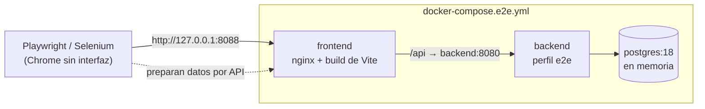

<!--
  Nombre: pruebas-e2e.md
  Descripción: Guía de las pruebas end-to-end del frontend: entorno docker-compose.e2e.yml, perfil e2e del
               backend, escenarios E2E-01 a E2E-10 con sus criterios, ejecución en Windows y Linux, y reportes
               de Playwright y Selenium WebDriver.
  Fecha de creación: 2026-10-21
  Última actualización: 2026-10-21
  Autor: Juan Pablo Artunduaga Pérez (generado con Claude Code)
-->

# Pruebas end-to-end (E2E)

Los mismos 10 escenarios se automatizan dos veces, con **Playwright** (`e2e/playwright/`) y con **Selenium
WebDriver + Mocha** (`e2e/selenium/`), contra el frontend compilado que levanta `docker-compose.e2e.yml`. Las dos
suites usan el patrón Page Object y localizan los elementos por `data-testid`.

## 1. Entorno



| Servicio | Imagen | Qué hace |
| --- | --- | --- |
| `postgres` | `postgres:18-alpine` | Base `ferreteria_e2e` en `tmpfs`: cada `up` después de un `down` empieza limpia. |
| `backend` | `backend/Dockerfile` | Spring Boot con `SPRING_PROFILES_ACTIVE=e2e`. Flyway aplica el esquema (`db/migration`) y el escenario de prueba (`db/e2edata/R__datos_prueba_e2e.sql`, copia de `database/02_datos_prueba.sql` sin `BEGIN`/`COMMIT`). |
| `frontend` | `frontend/Dockerfile` | `npm run build` servido por nginx; reenvía `/api` al backend, así el navegador no depende de CORS. Publica el puerto `E2E_PUERTO` (8088). |

**Perfil `e2e` del backend** (`application-e2e.properties`): los datos de prueba traen un usuario por rol con un
hash que no sirve para iniciar sesión. `InicializadorUsuariosE2e` guarda al arrancar el hash BCrypt de
`E2E_ADMIN_PASSWORD`, `E2E_JEFE_PASSWORD` y `E2E_VENDEDOR_PASSWORD` en los usuarios `admin`, `jefe` y `vendedor`,
y les quita intentos fallidos y bloqueo. Si falta alguna variable, el backend no arranca. Ninguna contraseña está en
el código ni en Git.

### Variables

Se toman de `.env` en la raíz (copiado de [`.env.example`](../.env.example), ignorado por Git). Docker Compose y
las dos suites leen el mismo archivo; una variable ya definida en el sistema (por ejemplo en CI) tiene prioridad.

| Variable | Uso |
| --- | --- |
| `E2E_PUERTO` | Puerto local del frontend (8088). |
| `E2E_DB_PASSWORD` | Contraseña de la base descartable. |
| `E2E_JWT_SECRET` | Clave de firma de los JWT (32 caracteres o más). |
| `E2E_ADMIN_PASSWORD`, `E2E_JEFE_PASSWORD`, `E2E_VENDEDOR_PASSWORD` | Contraseñas de los usuarios de prueba. |
| `E2E_BASE_URL` | Opcional; por defecto `http://127.0.0.1:<E2E_PUERTO>`. |

## 2. Escenarios

Cada escenario lleva en su nombre su id y los criterios que cubre (catálogo:
[`criterios-aceptacion.yaml`](criterios-aceptacion.yaml), campo `e2e`). Los criterios con sufijo `D<n>` son
derivados del flujo principal, la matriz 2.2 o la regla de internacionalización; el catálogo indica su origen.

| Escenario | Criterios | Qué verifica |
| --- | --- | --- |
| E2E-01 inicio de sesión correcto e incorrecto | CA-RF-SEG-001-D1 | Contraseña errada: aviso y sigue en `/login`. Correcta: entra a productos con el nombre del usuario. |
| E2E-02 crear producto | CA-RF-PRO-001-1 | Producto con garantía y plazo; notificación; la búsqueda lo muestra con marca, categoría, unidad, IVA y estado Activo. |
| E2E-03 validaciones del formulario | CA-RF-PRO-001-2, CA-RNF-INT-002-1 | Vacíos: cada obligatorio muestra su etiqueta y "Este campo es obligatorio". Nombre de 2 caracteres, porcentaje 501, nombre y descripción más largos que el máximo (se recortan a 150 y 500), garantía sin plazo. Nada se envía al servidor. |
| E2E-04 editar producto | CA-RF-PRO-001-D1 | Cambia nombre, marca y porcentaje; el nombre anterior ya no aparece. |
| E2E-05 buscar y filtrar | CA-RF-PRO-003-D1 | Tres productos propios (uno inactivo): búsqueda sin distinguir mayúsculas, filtros de categoría y estado combinados y aviso de sin resultados. |
| E2E-06 desactivar con confirmación | CA-RF-CFG-001-3 | Cancelar no cambia nada; confirmar deja el producto Inactivo, sin botón de desactivar y aún editable. |
| E2E-07 producto duplicado | CA-RF-PRO-001-3 | Mismo nombre y marca: el campo nombre muestra la causa del servidor. Con otra marca sí se registra. |
| E2E-08 el vendedor no ve acciones de edición | CA-RF-SEG-001-2, CA-RF-PRO-003-3 | Sin botones de crear, editar ni desactivar, sin columna de costos; la API le responde 403 al crear y desactivar. |
| E2E-09 ruta protegida sin sesión | CA-RNF-SEG-001-D1, CA-RNF-SEG-001-1 | `/productos` sin sesión lleva al login; `GET /api/v1/productos` sin token responde 401. |
| E2E-10 cambio de idioma | CA-RNF-INT-003-D1, CA-RNF-INT-003-1 | Arranca en español (`lang="es"`), moneda `$ 18.000`; en inglés cambian títulos, botones, menú y estados; la elección sobrevive a recargar y a cerrar sesión. |

**Datos.** Las pruebas no borran nada (los productos solo se desactivan). Cada una crea sus productos con un nombre
único (`E2E PW ...` o `E2E SE ...` más un sello de tiempo), y los que necesita de antemano los crea por API
(`e2e/comun/api.js`), así pueden repetirse sobre la misma base y las dos herramientas no chocan. El código común
(entorno, datos esperados y cliente de la API) está en `e2e/comun/`.

## 3. Cómo ejecutar

Requisitos: Docker Desktop en ejecución, Node.js 24 y Google Chrome (Selenium Manager descarga el chromedriver).

```powershell
# 1. Variables (una sola vez) y entorno
Copy-Item .env.example .env        # en Linux: cp .env.example .env ; luego cambiar los valores
docker compose -f docker-compose.e2e.yml up -d --build --wait

# 2. Playwright
cd e2e/playwright
npm ci
npx playwright install chromium    # una sola vez
npm test

# 3. Selenium
cd ../selenium
npm ci
npm test

# 4. Apagar el entorno (la base se descarta)
cd ../..
docker compose -f docker-compose.e2e.yml down
```

Opciones: `npm run test:con-interfaz` (Playwright con navegador visible), `E2E_CON_INTERFAZ=1` (Selenium con
navegador visible), `npm run reporte` (abre el reporte HTML de Playwright).

## 4. Reportes

| Herramienta | Archivo | Contenido |
| --- | --- | --- |
| Playwright | `e2e/playwright/reportes/html/index.html` | Reporte HTML con pasos, capturas y trazas. |
| Playwright | `e2e/playwright/reportes/junit/resultados-playwright.xml` | JUnit XML. |
| Playwright | `e2e/playwright/reportes/artefactos/` | Captura (`test-failed-1.png`) y traza (`trace.zip`, se abre con `npx playwright show-trace`) solo de las pruebas fallidas. |
| Selenium | `e2e/selenium/reportes/junit/resultados-selenium.xml` | JUnit XML (`mocha-junit-reporter`), con la captura como adjunto `[[ATTACHMENT\|...]]`. |
| Selenium | `e2e/selenium/reportes/capturas/` | Captura PNG de cada escenario fallido. |

Las carpetas `reportes/` están en `.gitignore`.

## 5. Decisiones y límites

- **Dos navegadores a la vez en Playwright, uno en Selenium.** El inicio de sesión bloquea la fila del usuario
  (`SELECT … FOR UPDATE`) mientras calcula BCrypt; con muchos navegadores iniciando sesión con el mismo usuario a la
  vez, las solicitudes se encolan y superan las esperas de 10 s. No es un error funcional, pero conviene medirlo en
  las pruebas de carga (RNF-REN-003).
- **127.0.0.1 en lugar de localhost.** Evita diferencias de resolución IPv4/IPv6 entre Windows y Linux.
- **nginx reenvía `Host` con el puerto** (`$http_host`): sin el puerto, Spring tomaba el login del navegador como
  una petición de otro origen y CORS la rechazaba con 403.
- **Mocha 11.** `mocha-junit-reporter` 2.2.1 no funciona con Mocha 12 (usa `Base.call` sobre una clase); se fija
  Mocha 11 hasta que el reportero se actualice.
- **HTTP dentro de Docker.** El entorno prueba la aplicación, no el certificado; HTTPS (RNF-SEG-006) lo aporta el
  despliegue.
- **CI.** El job `e2e` del pipeline levanta este mismo entorno en los runners Linux de GitHub Actions, con
  contraseñas aleatorias en cada ejecución, y publica los reportes HTML, JUnit, capturas y trazas como artefactos
  (ver [ci-cd.md](ci-cd.md), sección 5).
